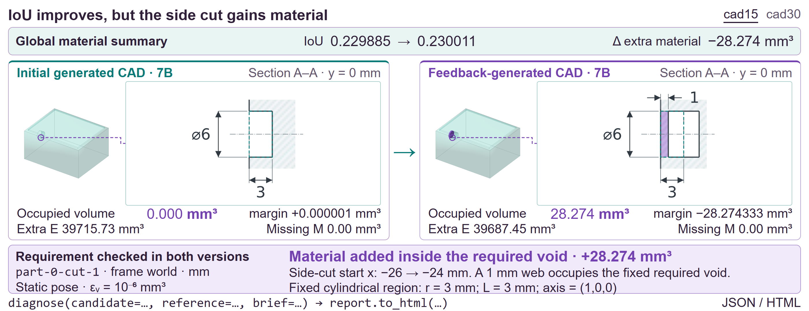
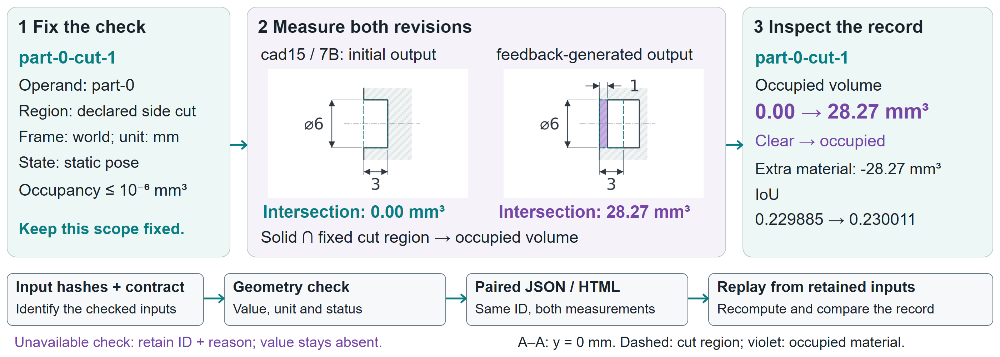
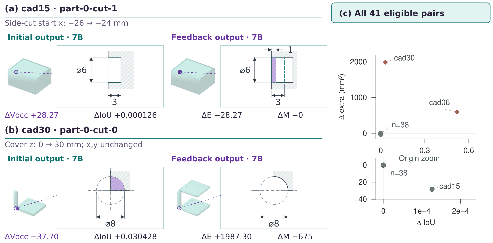
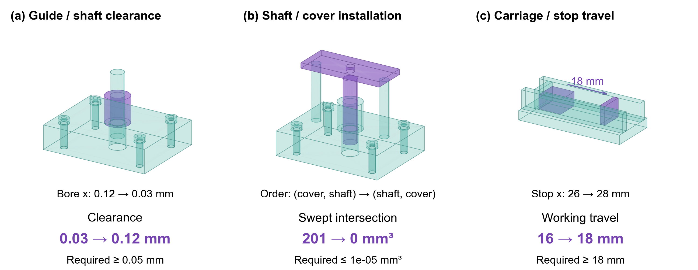

<div align="center">

# Hard-CAD: Contract-Based Diagnostics for Generated CAD Geometry

<p align="center">
  <strong>Don't just measure IoU. Diagnose the requirement.</strong>
</p>

[-blue.svg?logo=adobeacrobatreader&logoColor=white)](assets/Hard-CAD.pdf)
[-10b981.svg?logo=safari&logoColor=white)](index.html)
[](LICENSE)
[](https://www.python.org/)
[](https://www.freecad.org/)

<br />

<p align="center">
  <a href="#-interactive-project-page"><strong>Project Page</strong></a> •
  <a href="#-the-core-problem-the-iou-paradox"><strong>The IoU Paradox</strong></a> •
  <a href="#-key-features"><strong>Key Features</strong></a> •
  <a href="#-recorded-case-studies"><strong>Case Studies</strong></a> •
  <a href="#-quickstart--usage"><strong>Quickstart</strong></a> •
  <a href="#-repository-structure"><strong>Structure</strong></a> •
  <a href="#-citation"><strong>Citation</strong></a>
</p>

---


<p align="center"><em>Hard-CAD Diagnostic Workflow: Pairing declared requirements across revisions to diagnose local regressions hidden by global volume metrics.</em></p>

</div>

---

## 🌟 Interactive Project Page

We provide a comprehensive, standalone academic project homepage ready for browsing and deployment:
- **Online / Local Entry Point:** [`index.html`](index.html)
- **Included Features:**
  - 🔄 **Interactive Case Switcher:** Toggle between `cad15` and `cad30` before/after geometry and paired diagnostic reports.
  - 📐 **B-Rep & Contract Visualizer:** High-resolution architectural diagrams and cohort distribution plots.
  - 📋 **Live Snippet Tabs:** One-click copyable CLI commands, Python API calls, and YAML schema contracts.
  - 📄 **Full Manuscript Access:** Embedded link to [`assets/Hard-CAD.pdf`](assets/Hard-CAD.pdf).

---

## 🚨 The Core Problem: The IoU Paradox

In generative CAD and iterative model repair, standard evaluation protocols rely on **Intersection over Union (IoU)** or **Chamfer Distance**. However, precision mechanical engineering demands strict compliance with localized functional requirements (e.g., clearance holes, through-bores, and keep-out volumes).

A model revision can substantially **improve global IoU** while introducing a **catastrophic local regression**:

| Metric / Requirement | Initial Candidate | Revised Candidate | Outcome / Verdict |
| :--- | :---: | :---: | :--- |
| **Global IoU** | Baseline | **+0.000126 ↑** | Apparent Global Improvement |
| **Extra Material Volume** | Baseline | **-28.27 mm³ ↓** | Apparent Material Reduction |
| **Requirement `part-0-cut-0`** | FAIL (38,059 mm³) | FAIL (38,003 mm³) | Still Failing |
| **Requirement `part-0-cut-1` (Side-Cut)** | **PASS (0.00 mm³)** | **FAIL (28.27 mm³) ❌** | **Critical Regression Introduced!** |

*In `cad15` (above), the generative agent removed excess material from the body, improving overall IoU. However, it mistakenly filled in a pre-existing, valid side-cut. Standard metrics celebrate this as progress; **Hard-CAD detects the regression immediately**.*

---

## ⚙️ Key Features

- **Formal Schema Contracts (`brief.yaml`):** Explicitly defines required and forbidden regions (boxes, cylinders, spheres), coordinate reference frames, units, and strict tolerances ($10^{-6}\text{ mm}^3$).
- **Deterministic Kernel Execution:** Directly invokes OpenCASCADE B-Rep Boolean operations via FreeCAD without mesh discretization artifacts.
- **Paired Revision Differencing:** Pairs requirements across candidate versions $M_1$ and $M_2$, computing categorical state transitions (`PASS` $\leftrightarrow$ `FAIL`) alongside signed volumetric deltas.
- **Audited Document Dimension Extraction:** Evaluated on real engineering specifications, achieving **12/12 Precision** and **12/13 Recall** on explicit dimension triples.
- **100% Executable & Local:** No cloud API dependencies, private CAD suites, or non-deterministic GPU engines required for verification.

<div align="center">
  
</div>

---

## 🔬 Recorded Case Studies

Ready-to-open case study bundles include YAML contracts, STEP files, and paired HTML/JSON reports:

### 1. `cad15`: IoU Improves, Declared Side-Cut Regresses
- **Folder:** [`examples/cad15_iou_improves_cut_regresses/`](examples/cad15_iou_improves_cut_regresses/)
- **Summary:** Global IoU rises $+0.000126$, extra material drops $-28.27\text{ mm}^3$, yet `part-0-cut-1` regresses from $0.00\text{ mm}^3$ (PASS) to $28.27\text{ mm}^3$ (FAIL).
- **Report:** View [`report.html`](examples/cad15_iou_improves_cut_regresses/report.html).

### 2. `cad30`: Declared Void Clears, Extra Material Grows
- **Folder:** [`examples/cad30_void_clears_extra_grows/`](examples/cad30_void_clears_extra_grows/)
- **Summary:** Blocked cylinder void successfully clears ($37.70\text{ mm}^3 \to 0.00\text{ mm}^3$, PASS), but collateral geometry grows by $+1987.30\text{ mm}^3$.
- **Report:** View [`report.html`](examples/cad30_void_clears_extra_grows/report.html).

---

## 🚀 Quickstart & Usage

### 1. Installation

Install the package in your Python environment:
```bash
git clone https://github.com/Hard-CAD/hard-cad.git
cd hard-cad
pip install -e ".[yaml]"
```

*Note: FreeCAD (tested on 1.1.x) supplies the underlying geometric execution kernel.*

### 2. Run the Benchmark Demo

Run the recorded verification demo to evaluate sample STEP files against the contract:
```bash
hardcad demo --output paper-demo --cad-python python
```
Then open `paper-demo/index.html` in your browser to view the generated diagnostic cards.

### 3. Python API

```python
from hardcad import diagnose

# Run contract diagnostics against candidate and reference geometry
report = diagnose(
    candidate="model.step",
    reference="reference.step",
    brief="brief.yaml",
    cad_python="python"  # Path to FreeCAD/OCP python binary
)

# Export interactive report
report.to_html("diagnosis.html")
print(report.summary())
```

### 4. Sample Contract Specification (`brief.yaml`)

```yaml
schema_version: hardcad.contract.v1
unit: mm
frame: world
state: recorded_static_pose
requirements:
  - id: part-0-cut-0
    kind: keep_out
    region:
      kind: box
      origin: [-23, -18, 2]
      size: [46, 36, 23]
    tolerance_mm3: 1.0e-06
  - id: part-0-cut-1
    kind: keep_out
    region:
      kind: cylinder
      origin: [-25, 0, 12]
      radius: 3
      height: 3
      axis: [1, 0, 0]
    tolerance_mm3: 1.0e-06
```

---

## 📊 Experimental Results

Across 30 modeling briefs and 41 eligible revision pairs, Hard-CAD analyzed 84 paired cut instances:

<div align="center">
  
  
  <p><em>Left: Revision cohort distribution (IoU vs volume deltas). Right: Multi-stage agent repair attempts.</em></p>
</div>

---

## 📁 Repository Structure

```text
hard-cad/
├── index.html                               # Standalone interactive academic project homepage
├── README.md                                # Repository guide & documentation
├── assets/
│   ├── Hard-CAD.pdf                         # Manuscript (Computers & Graphics)
│   ├── diagnostic_concept.png               # Workflow Figure 1
│   ├── contract_revision_workflow.png       # Architecture Figure 2
│   ├── revision_cohort.png                  # Benchmark cohort scatter plot
│   └── agent_repair_examples.png            # Multi-agent repair cases
└── examples/
    ├── cad15_iou_improves_cut_regresses/    # Case study 1 (regression with IoU gain)
    ├── cad30_void_clears_extra_grows/       # Case study 2 (void cleared, material expanded)
    ├── contract_proposals/                  # Proposal replay protocols
    ├── entity_screen/                       # Screen and filter protocols
    └── semantic_binding/                    # Multi-view CLIP binding example
```

---

## 📖 Citation

If you find this work or benchmark useful in your research, please cite:

```bibtex
@article{hardcad2026,
  title   = {Hard-CAD: Contract-Based Diagnostics for Generated CAD Geometry},
  journal = {Computers \& Graphics},
  year    = {2026},
  note    = {Under Review}
}
```

---

## 📄 License

This repository is distributed under the MIT License. See [LICENSE](LICENSE) for details.
