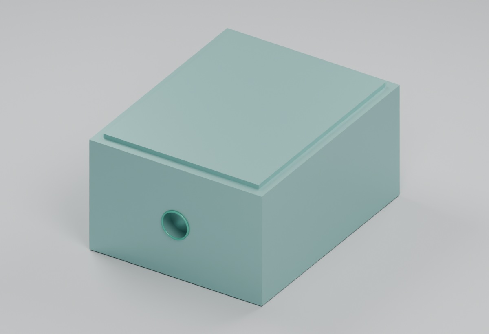
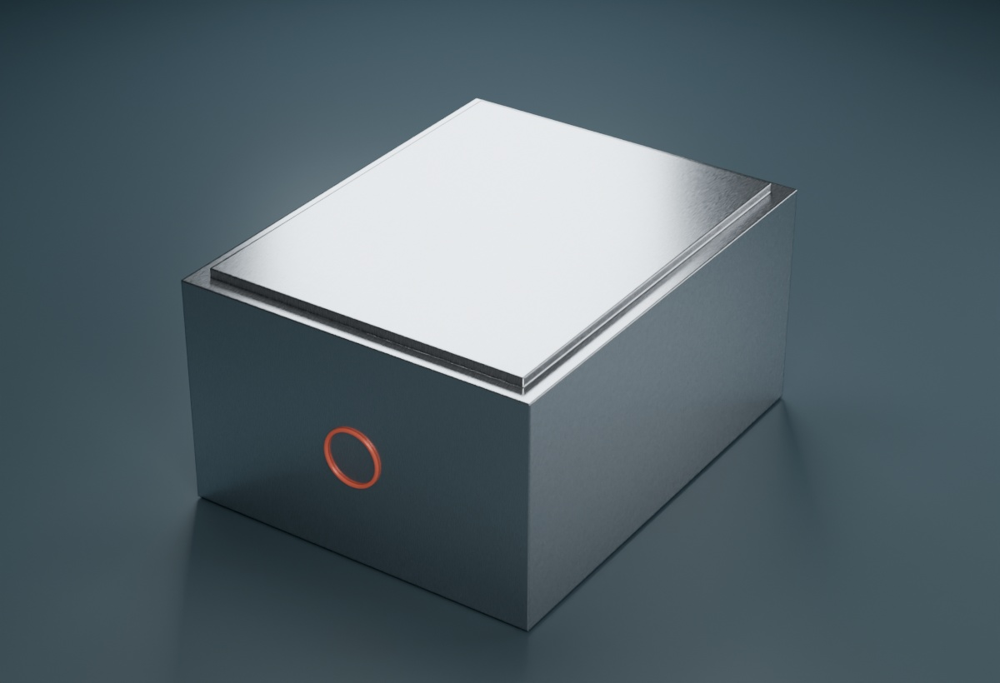
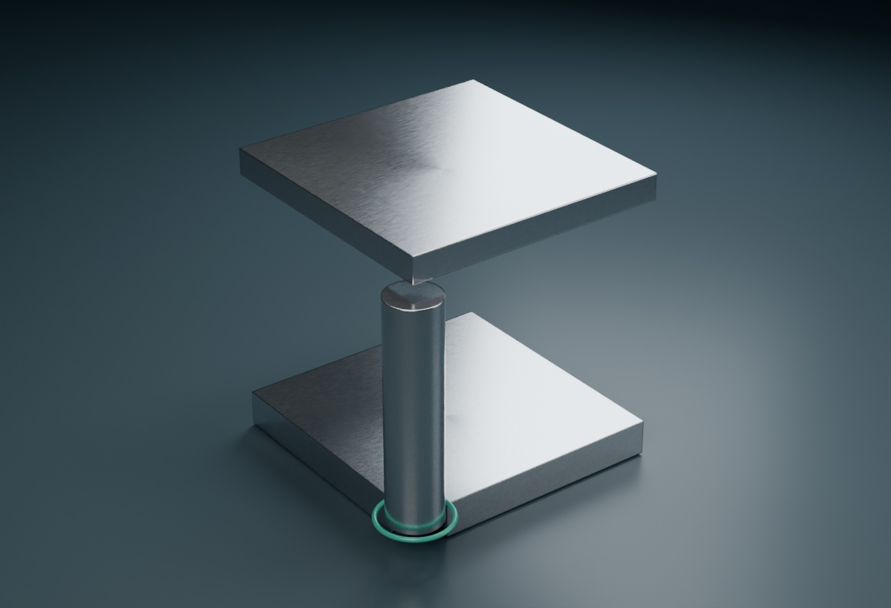
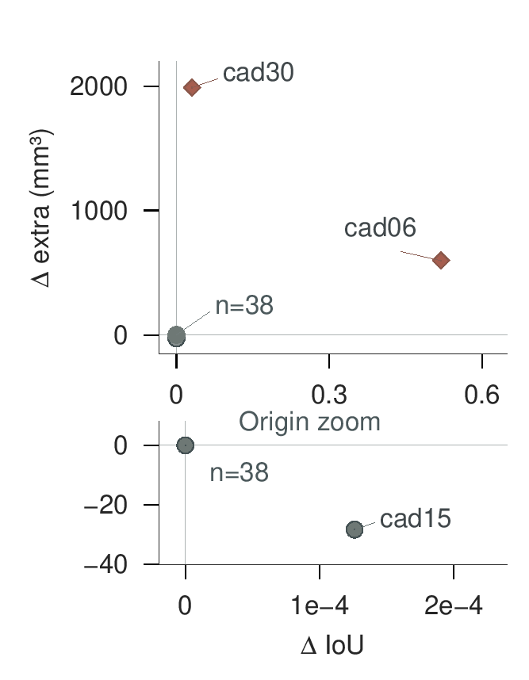

# Hard-CAD

**Contract-based diagnostics for generated CAD geometry**

Hard-CAD follows the same declared requirement across two CAD versions. The paired report shows the measurement, verdict, and reason when a value is unavailable, alongside changes in overall geometry.

[Project page](https://hard-cad.github.io/hard-cad/) · [3D comparison](https://hard-cad.github.io/hard-cad/inspect.html) · [Evidence replay](https://hard-cad.github.io/hard-cad/replay.html) · [Process pump demo](https://hard-cad.github.io/hard-cad/machine-demo.html) · [Paper](https://doi.org/10.1016/j.cag.2026.104824)

## When a better overlap score hides a blocked cut

In **cad15**, intersection over union (IoU) rose from **0.229885 to 0.230011** and total extra material fell by **28.27 mm³**. The same revision added **28.27 mm³** inside a side-cut that had been clear.

| Initial · side-cut clear | Revision · side-cut occupied |
| :---: | :---: |
|  |  |
| **0.00 mm³** occupied | **28.27 mm³** occupied |

The rings locate the declared region in the same view. See the [paired report](examples/cad15_iou_improves_cut_regresses/report.html), [contract](examples/cad15_iou_improves_cut_regresses/contract.json), and [recorded changes](examples/cad15_iou_improves_cut_regresses/difference.json).

## How it works

1. **Declare the requirement.** Record the entities or region, frame, units, state, and acceptance bound.
2. **Measure both versions.** The reference and the declared checking conditions stay fixed across the pair. The CAD kernel supplies the measurements.
3. **Read the transition.** Follow the same requirement ID across the two verdicts and compare its value with the global change. Unavailable values keep their status and reason.

## A void can clear while extra material grows

In **cad30**, occupancy in the declared base void fell from **37.70 mm³ to zero**. The revision also added **1,987.30 mm³** of net extra material outside the reference.

| Initial · base void occupied | Revision · base void clear |
| :---: | :---: |
|  |  |
| **37.70 mm³** occupied | **0.00 mm³** occupied |

See the [paired report](examples/cad30_void_clears_extra_grows/report.html), [contract](examples/cad30_void_clears_extra_grows/contract.json), and [recorded changes](examples/cad30_void_clears_extra_grows/difference.json).

## Cohort results

The study covers **30 modeling briefs** and **41 eligible revision pairs**. Three pairs changed the measured material volumes. Of **84 paired cut requirements**, 63 stayed clear, 19 stayed violated, one became violated, and one cleared.

A separate document audit recovered 12 of 13 explicit dimension triples. All 12 returned triples were correct.



## Open the examples

- [3D comparison](https://hard-cad.github.io/hard-cad/inspect.html) lets you rotate the model, switch versions, and select a requirement.
- [Evidence replay](https://hard-cad.github.io/hard-cad/replay.html) walks through recorded local and global changes.
- [cad15 bundle](examples/cad15_iou_improves_cut_regresses/) and [cad30 bundle](examples/cad30_void_clears_extra_grows/) include the STEP files, contracts, and HTML and JSON reports.

To browse locally, clone the repository and serve its root directory:

```sh
git clone https://github.com/Hard-CAD/hard-cad.git
cd hard-cad
python -m http.server 8000 --bind 127.0.0.1
```

Open [http://127.0.0.1:8000/](http://127.0.0.1:8000/). The browser viewer opens the recorded measurements with the public display meshes.

The README renders use the same public display meshes under matched camera and lighting for each pair. The [render script](tools/render_readme_cases.py) documents how to regenerate them. The bundle manifests record the geometry sources for [cad15](examples/cad15_iou_improves_cut_regresses/provenance.json) and [cad30](examples/cad30_void_clears_extra_grows/provenance.json).

## Citation

```bibtex
@article{hardcad2026,
  author  = {Hikoyan Huang and Jiayao Zhang},
  title   = {Hard-CAD: Contract-Based Diagnostics for Generated CAD Geometry},
  journal = {Computers \& Graphics},
  year    = {2026},
  pages   = {104824},
  doi     = {10.1016/j.cag.2026.104824}
}
```

## License

This repository is distributed under the MIT License.
