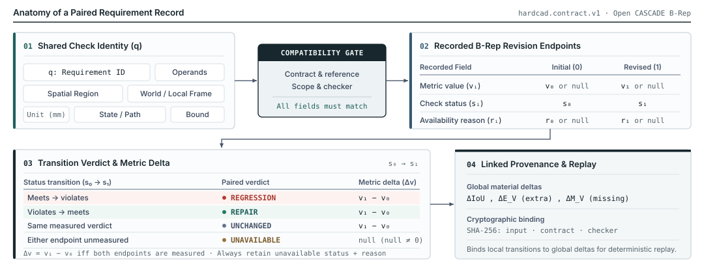
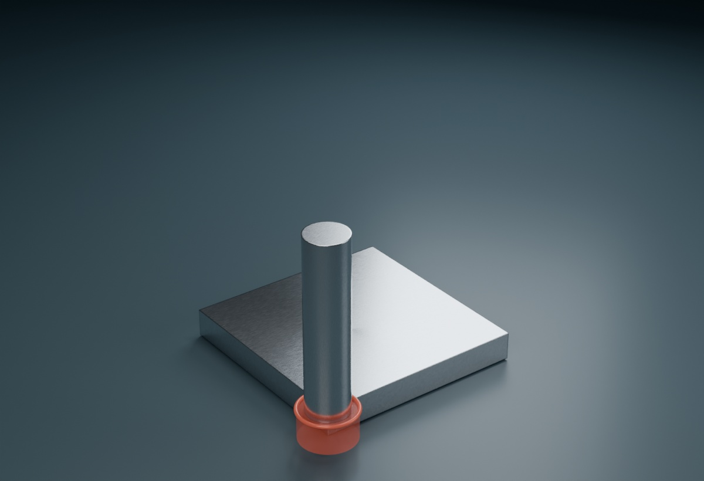
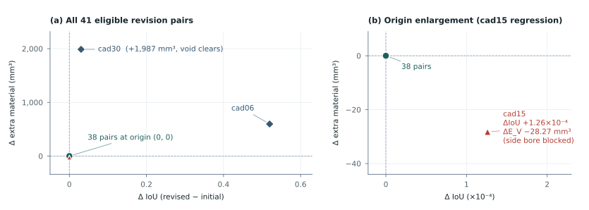
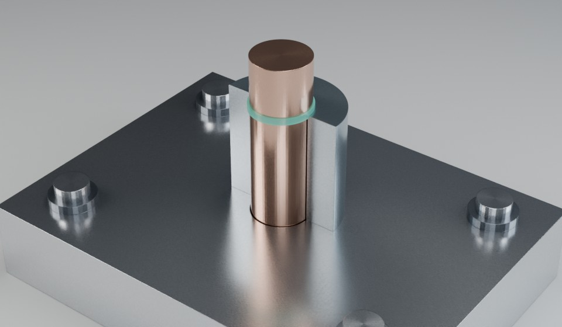
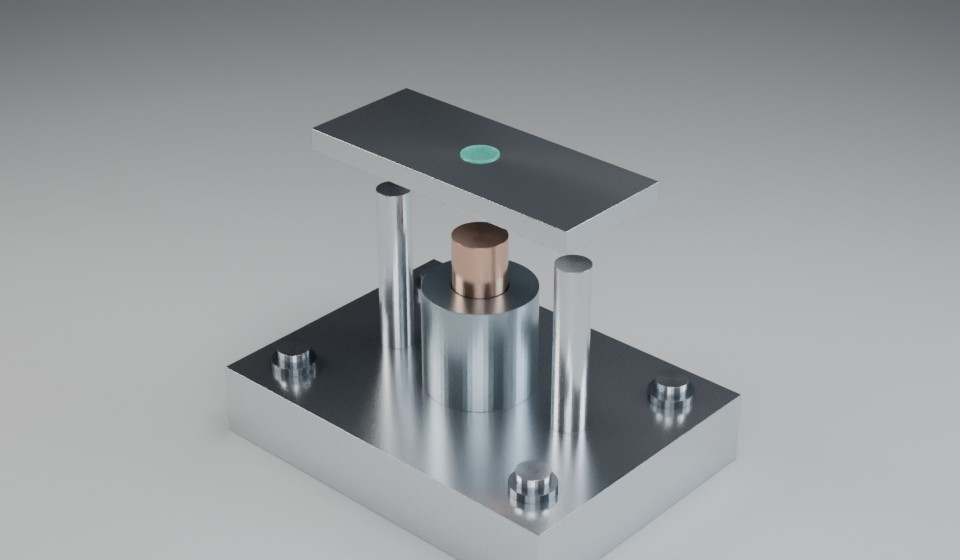
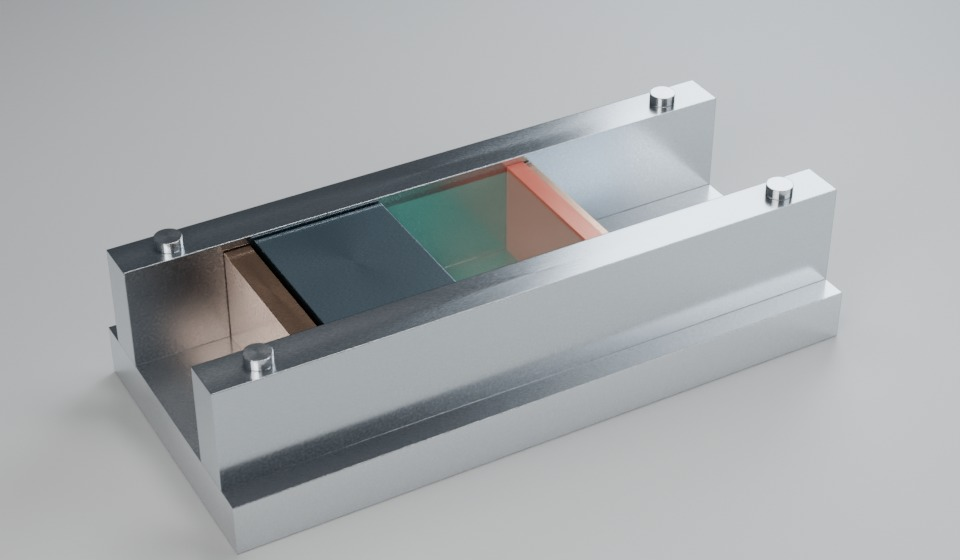

# Hard-CAD

**Contract-based diagnostics for generated CAD geometry** · *Computers & Graphics (CAD/Graphics 2026)*

[](https://hard-cad.github.io/hard-cad/) [](https://hard-cad.github.io/hard-cad/inspect.html) [](https://doi.org/10.1016/j.cag.2026.104824)

**Global IoU went up. Extra material went down. Yet the Ø6 mm side bore was sealed shut.**
Hard-CAD pairs the same declared geometric requirement across CAD revisions, reporting exact B-Rep measurements, transition verdicts, and availability reasons alongside global material changes.

## When a better overlap score hides a blocked cut

In **cad15**, global intersection-over-union (IoU) rose from **0.229885 to 0.230011** and total extra material fell by **28.27 mm³**. The same revision added **28.27 mm³** inside a declared Ø6 mm side-cut (`part-0-cut-1`) that had been clear.

| Initial · side-cut clear | Revision · side-cut occupied |
| :---: | :---: |
|  |  |
| **0.00 mm³** occupied (`PASS`) | **28.27 mm³** occupied (`FAIL`) |

The rings mark the declared keep-out region in the same view. Inspect the [paired report](examples/cad15_iou_improves_cut_regresses/report.html), [contract](examples/cad15_iou_improves_cut_regresses/contract.json), and [recorded changes](examples/cad15_iou_improves_cut_regresses/difference.json), or orbit the meshes in the [3D Studio](https://hard-cad.github.io/hard-cad/inspect.html?case=cad15).

## How it works

<p align="center">
  
</p>

1. **Declare the requirement.** Record the requirement ID (`q`), operands, spatial region, coordinate frame, units, evaluation state/path, and acceptance bound.
2. **Measure both versions.** The reference and checking conditions stay fixed across the pair while the Open CASCADE B-Rep kernel computes exact solid measurements.
3. **Read the transition.** Pair both endpoints on the same requirement ID (`REGRESSION`, `REPAIR`, `UNCHANGED`, or `UNAVAILABLE`, preserving `null ≠ 0`) and bind local transitions to global deltas with SHA-256 provenance.

## A void can clear while extra material grows

In **cad30**, occupancy in the declared base void (`part-0-cut-0`) fell from **37.70 mm³ to 0.00 mm³**, while net extra material elsewhere grew by **+1,987.30 mm³**.

| Initial · base void occupied | Revision · base void clear |
| :---: | :---: |
|  |  |
| **37.70 mm³** occupied (`FAIL`) | **0.00 mm³** occupied (`PASS`) |

See the [paired report](examples/cad30_void_clears_extra_grows/report.html), [contract](examples/cad30_void_clears_extra_grows/contract.json), and [recorded changes](examples/cad30_void_clears_extra_grows/difference.json).

## Cohort results & controlled studies

| Modeling briefs | Eligible revision pairs | Paired cut requirements |
| :---: | :---: | :---: |
| **30** | **41** | **84** |

<p align="center">
  
</p>

Three pairs changed the measured material volumes. Among the 84 matched cuts, **63 stayed clear**, **19 stayed violated**, **1 regressed (`cad15`)**, and **1 cleared (`cad30`)**. A separate 22-document audit recovered **12 of 13** explicit-unit dimension triples with no unmatched outputs.

| (a) Guide / shaft clearance | (b) Shaft / cover installation | (c) Carriage / stop travel |
| :---: | :---: | :---: |
|  |  |  |
| `0.03 → 0.12 mm` (`≥ 0.05 mm`) | `201.06 → 0.00 mm³` (`≤ 10⁻⁵ mm³`) | `16 → 18 mm` (`≥ 18 mm`) |

## Explore locally

- [3D Studio](https://hard-cad.github.io/hard-cad/inspect.html): side-by-side or overlaid metallic WebGL comparison with live cutaway and contract region binding.
- [Evidence replay](https://hard-cad.github.io/hard-cad/replay.html): lightweight archived readout replay for `cad15` and `cad30`.
- [cad15 bundle](examples/cad15_iou_improves_cut_regresses/) and [cad30 bundle](examples/cad30_void_clears_extra_grows/): STEP models, contracts, provenance manifests, and HTML/JSON reports.

To browse locally, clone the repository and serve its root directory:

```sh
git clone https://github.com/Hard-CAD/hard-cad.git
cd hard-cad
python -m http.server 8000 --bind 127.0.0.1
```

Open [http://127.0.0.1:8000/](http://127.0.0.1:8000/). The web studio displays the public meshes alongside archived B-Rep measurements.

The studio renders use the public display meshes under matched Blender Cycles lighting and camera poses via [render_metallic_studio.py](tools/render_metallic_studio.py), [render_controlled_studies.py](tools/render_controlled_studies.py), and [render_carriage_travel.py](tools/render_carriage_travel.py). Geometry sources are recorded in the manifests for [cad15](examples/cad15_iou_improves_cut_regresses/provenance.json) and [cad30](examples/cad30_void_clears_extra_grows/provenance.json).

## Citation

```bibtex
@article{hardcad2026,
  author  = {Huang, Hikoyan and Zhang, Jiayao},
  title   = {Hard-CAD: Contract-Based Diagnostics for Generated CAD Geometry},
  journal = {Computers \& Graphics},
  year    = {2026},
  pages   = {104824},
  doi     = {10.1016/j.cag.2026.104824},
  url     = {https://hard-cad.github.io/hard-cad/}
}
```

## License

This repository is distributed under the MIT License.
